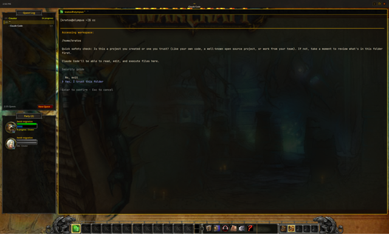

# herd-the-warcraft

A World of Warcraft–style layout for [herdr-app](https://herdr.dev): a Quest Log
of spaces, a Party of agents with health and mana bars, an action bar of tabs
between two gryphons, pane nameplates, and a random Classic / Burning Crusade /
Wrath loading screen behind each space.



## Install

```sh
git clone git@github.com:enzonaut/herd-the-warcraft.git
cd herd-the-warcraft
./install.sh
```

Then restart Herdr once (it loads the fonts at start) and switch to the layout
with `Ctrl+Shift+L`, or pick **Warcraft** in Settings. No WoW install is needed.

To update: `git pull && ./install.sh`.

## What's what

| | |
|---|---|
| Zone bar | the space as zone text, the tab as subzone, clock, window buttons |
| Quest Log | spaces as quests, colored by status; the shown space's tabs as objectives |
| Party | agents as unit frames: mana moves while working, green glow when ready, red flash when it needs you |
| Action bar | slots 1–12 are tabs (`Ctrl+1`–`9`), micro menu (new tab, splits, palette, settings, help), bags = spaces 1–5 |
| Backgrounds | each space rolls a random loading screen (87, Classic–Wrath only), shown 15% through terminals and panels |
| Copied popup | a WoW tooltip in the middle of the window when you highlight text |
| Damage meter | tokens spent per agent, biggest spender on top: total, rate over the last minute, share; click the title for output tokens only (Claude Code agents; needs `python3`) |

`layouts/warcraft.json` changes on its own as you switch spaces (it holds the
current background); that's expected.
